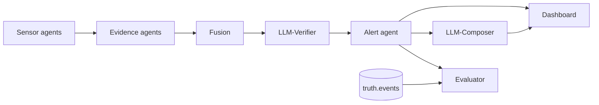

# RockWatch-FuseGuard (SIH25071)

Multi-agent rockfall/landslide early-warning prototype, demonstrated by **historical replay**.
Team: Rumita Mandal (12310268), Guruansh Singh (12320056).

> **US natural-slope and road-cut data — not open-pit mine performance. Reported precision is a lower bound (unreported
> events exist). Lead time is in days (daily inputs); the system never predicts a time of failure.**

## What it does
1. **Sensor agents** replay real daily weather (Open-Meteo archive) and earthquakes (USGS ComCat) zone by zone.
2. **Evidence agents** turn each stream into a calibrated log-odds contribution; the **fusion agent** combines them
   (quality-weighted) into a daily probability and alert level (L0 Normal · L1 Watch · L2 Warning · L3 Alarm).
3. **LLM agents** verify L2+ escalations with read-only tools (can never raise a level), write operator messages, and answer
   questions from logged records only. All rules are enforced in code.
4. **Ground truth** (USGS Landslide Inventories v3.0; USGS DS746 Yosemite rock falls) is used only for labels and evaluation.

Regions (frozen at CP1): **A** Anchorage / Seward Highway, Alaska (AK DOT rockfall log, 0.25° zones, 2006–2022) and
**Y** Yosemite Valley rockfall track (DS746, one zone, 1951–2011). See `docs/data_profile.md`, `docs/data_card.md`.

## Setup (Windows / macOS / Linux)
```
python -m venv .venv
# Windows:  .venv\Scripts\activate        macOS/Linux:  source .venv/bin/activate
pip install -e ".[ui,llm,dev]"
copy .env.example .env      # macOS/Linux: cp .env.example .env ; set ROCKWATCH_LLM_PROVIDER (mock|anthropic|ollama)
```
Python ≥ 3.10 works (3.11+ recommended). No geopandas, no bash scripts — everything is `python -m rockwatch ...`.

## Pipeline
```
python -m rockwatch fetch-inventory             # or place US_Landslide_v3_csv.zip in data/raw/usgs_ls_v3/
python -m rockwatch profile                     # docs/data_profile.md
python -m rockwatch build-zones
python -m rockwatch fetch-weather               # Open-Meteo free tier is quota-limited: resumable, re-run until remaining=0
python -m rockwatch build-data                  # features, labels, splits, quakes, docs/data_card.md
python -m rockwatch train                       # fusion + ablations, Platt + thresholds on validation
python -m rockwatch eval --split val [--llm on]
python -m rockwatch cp2-packet --region A       # CP2 decisions (no test labels read)
python -m rockwatch eval --split test --final [--llm on]   # once, after CP2
python -m rockwatch run-demo --scenario dev_val [--llm on] # 16 agent processes + replay + dashboard
python -m rockwatch run-demo --scenario dev_val --headless --kill-agent sensor_rain_0 --kill-at-day 20
python -m rockwatch agents status | agents kill <agent_id>
python -m rockwatch ask "Which alerts were raised in r9c8?"
pytest -q
```

## Architecture
See `docs/architecture.md` (mermaid diagram), `docs/evaluation.md`, `docs/llm_guardrails.md`, `docs/demo_script.md`.



## Results
**Pending CP2 and the final test run.** Headline numbers will be copied verbatim from `reports/eval_*_test/metrics.md`.
Validation-only numbers are in `reports/` (optimistic: thresholds are tuned there) and `docs/cp2_packet_*.md`.

## Limitations
- Inputs are daily reanalysis weather (~9–25 km) and a regional quake catalogue: no slope displacement is observed, so this is
  short-horizon risk estimation, not event detection.
- Truth inventories are incomplete and biased (region A: one highway agency's maintenance log; Yosemite: eyewitness bias),
  so false positives are inflated and precision is a lower bound.
- Region A road cuts are engineered slopes, closer to mine benches than natural slopes, but still not mine data.
- Open-Meteo's free tier limits weather fetching (≈36 zone-histories/day); region B (Puget Sound) was dropped for that reason.
- Nothing here is field-validated.

## Adapting to an open-pit mine
Keep the bus, envelope, fusion, alert, LLM-guardrail and evaluation contracts. Swap the sensor/evidence agents for
prism/radar displacement (inverse-velocity evidence), piezometer and geophone agents; replace the inventory truth with the
mine's incident log; recalibrate thresholds per site with a geotechnical engineer. Nothing in this prototype is field-validated.

## Data & licences
USGS *Landslide Inventories across the United States* v3.0, DOI 10.5066/P14AJF8I (CC0) · USGS Data Series 746 (Yosemite rock falls) ·
USGS ComCat · **Weather data by Open-Meteo.com** (CC BY 4.0).
