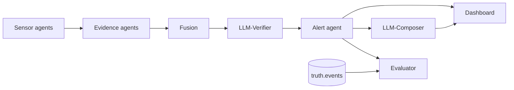

# RockWatch-FuseGuard (SIH25071)

Multi-agent rockfall/landslide early-warning prototype, demonstrated by **historical replay**.
Team: Rumita Mandal (12310268), Guruansh Singh (12320056).

> **US natural-slope and road-cut data — not open-pit mine performance. Reported precision is a lower bound (unreported
> events exist). Lead time is in days (daily inputs); the system never predicts a time of failure.**

## What it does
1. **Sensor agents** replay real daily weather (Open-Meteo archive) and earthquakes (USGS ComCat) zone by zone.
2. **Evidence agents** turn each stream into a calibrated log-odds contribution; the **fusion agent** combines them
   (quality-weighted) into a daily probability and alert level (L0 Normal · L1 Watch · L2 Warning · L3 Alarm).
3. **LLM agents** verify L2+ escalations with read-only tools (can never raise a level), write operator messages, and answer
   questions from logged records only. All rules are enforced in code.
4. **Ground truth** (USGS Landslide Inventories v3.0; USGS DS746 Yosemite rock falls) is used only for labels and evaluation.

Regions (frozen at CP1): **A** Anchorage / Seward Highway, Alaska (AK DOT rockfall log, 0.25° zones, 2006–2022) and
**Y** Yosemite Valley rockfall track (DS746, one zone, 1951–2011). See `docs/data_profile.md`, `docs/data_card.md`.

## Setup (Windows / macOS / Linux)
```
python -m venv .venv
# Windows:  .venv\Scripts\activate        macOS/Linux:  source .venv/bin/activate
pip install -e ".[ui,llm,dev]"
copy .env.example .env      # macOS/Linux: cp .env.example .env ; set ROCKWATCH_LLM_PROVIDER (mock|groq|anthropic|ollama)
```
Python ≥ 3.10 works (3.11+ recommended). No geopandas, no bash scripts — everything is `python -m rockwatch ...`.

## Pipeline
```
python -m rockwatch fetch-inventory             # or place US_Landslide_v3_csv.zip in data/raw/usgs_ls_v3/
python -m rockwatch profile                     # docs/data_profile.md
python -m rockwatch build-zones
python -m rockwatch fetch-weather               # Open-Meteo free tier is quota-limited: resumable, re-run until remaining=0
python -m rockwatch build-data                  # features, labels, splits, quakes, docs/data_card.md
python -m rockwatch train                       # fusion + ablations, Platt + thresholds on validation
python -m rockwatch eval --split val [--llm on]
python -m rockwatch cp2-packet --region A       # CP2 decisions (no test labels read)
python -m rockwatch eval --split test --final [--llm on]   # once, after CP2
python -m rockwatch run-demo --scenario dev_val [--llm on] # 16 agent processes + replay + control room (opens browser)
python -m rockwatch ui [--run DIR]              # control room over any recorded/live run: http://localhost:8600
python -m rockwatch run-demo --scenario dev_val --headless --kill-agent sensor_rain_0 --kill-at-day 20
python -m rockwatch agents status | agents kill <agent_id>
python -m rockwatch ask "Which alerts were raised in r9c8?"
pytest -q
```

## Quick start on Windows
Double-click, in this order:
1. **`RUN_ALASKA_PIPELINE.bat`** — finishes the Alaska weather download (pauses for the Open-Meteo hourly quota and resumes on its
   own; safe to close and re-run), then rebuilds features, retrains, evaluates on **validation** and refreshes the CP2 packet.
2. **`START_LIVE_DEMO.bat`** — live replay with all 16 agents + control room (default `dev_val_Y`; `START_LIVE_DEMO.bat dev_val`
   for Alaska). **`START_CONTROL_ROOM.bat`** only browses recorded runs and reports.
3. **`FINAL_TEST_EVAL.bat`** — the one-time sealed test evaluation (CP2 approved). With `GROQ_API_KEY` (free, console.groq.com)
   or `ANTHROPIC_API_KEY` in `.env` it first runs the real-LLM smoke test, then evaluates A and Y with and without the LLM
   verifier; without a key it asks before running without it. Refuses while any region's data is partial.

**LLM providers.** `groq` (free tier; `openai/gpt-oss-20b` verifier, `openai/gpt-oss-120b` writer), `anthropic`, `ollama`
(local) or `mock` (rule stand-in, labelled MOCK everywhere). Groq's free tier is rate limited (about 8K tokens/min, 200K
tokens/day per model), so offline evaluation paces calls (7.5 s) and verifies at most 80 L2+ candidates per region and run,
highest probability first; the rest keep the deterministic level and are counted as `FALLBACK_CAP` in the report.

After step 3 the approved test-period scenarios become replayable: `storm_A`, `quiet_A`, `quake_A`, `storm_Y`, `quiet_Y`,
`quake_Y` (e.g. `START_LIVE_DEMO.bat quake_A`). Before it they are refused so the test period is scored once, first.

## Control room (web UI)
`run-demo` opens **http://localhost:8600** — a dependency-free local web app (Python stdlib server + vanilla JS; Leaflet and
IBM Plex fonts are vendored, so it works offline). Keyboard: `1`–`6` views, `Space` pause, `←`/`→` step days, `Esc` back to latest.
- **Top bar** — run picker (region · window · start time), sim date, status, and an **LLM pill**: `MOCK` (rule-based stand-in,
  not a real LLM), `GROQ` / `CLAUDE` / `LOCAL` (real provider, model from the run's call log), `OFF`, or `NO KEY`.
- **Replay track** — one segment per sim-day coloured by the highest level, ◆ reported events; click/drag to inspect any closed
  day (map, KPIs, alerts and zone charts switch to that day), speed 0.5× / 1× / 2× during a live run (agent deadlines scale with it).
- **Overview** — zone map on keyless basemaps (Terrain = OpenTopoMap, Streets = OpenStreetMap, or Off; falls back automatically if
  tiles are unreachable), escalations pulse, ◆ events grouped per zone after their day closes; level timeline (multi-zone: zones per
  level; Yosemite single zone: daily p over the day's level with t1/t2/t3); latest alerts.
- **Zone detail** — rainfall vs the Seattle threshold, calibrated p with t1/t2/t3, per-modality “why” bars, evidence values, verifier
  note; explains when t2 ≈ t3 (L2 then appears only without corroboration).
- **Alerts** — composed messages with allowed actions, verifier decision + rationale, drivers, **Acknowledge**; L0↔L1 flips are
  grouped into watch periods and same-day re-notifications into one card (toggle).
- **Agents** — heartbeats of every process, supervisor stale flags, LLM call log, fault injection (kill/restart rain sensor,
  LLM offline, drop a zone's data).
- **Evaluation** — any report: RockWatch vs baselines with bootstrap CIs, thresholds, ablations, subset recall, figures.
- **Analyst** — questions answered only from logged records with record ids; refuses time-of-failure / field-performance questions.

The replay-recall KPI is illustrative (short window) and shows the alert-day share plus the recall independent random alerts at
that share would get (1 − (1 − f)²). Light/dark theme, reduced motion respected. Streamlit fallback: `run-demo --ui streamlit`.

## Architecture
See `docs/architecture.md` (mermaid diagram), `docs/evaluation.md`, `docs/llm_guardrails.md`, `docs/demo_script.md`.



## Results
**Pending CP2 and the final test run.** Headline numbers will be copied verbatim from `reports/eval_*_test/metrics.md`.
Validation-only numbers are in `reports/` (optimistic: thresholds are tuned there) and `docs/cp2_packet_*.md`.

## Limitations
- Inputs are daily reanalysis weather (~9–25 km) and a regional quake catalogue: no slope displacement is observed, so this is
  short-horizon risk estimation, not event detection.
- Truth inventories are incomplete and biased (region A: one highway agency's maintenance log; Yosemite: eyewitness bias),
  so false positives are inflated and precision is a lower bound.
- Region A road cuts are engineered slopes, closer to mine benches than natural slopes, but still not mine data.
- Open-Meteo's free tier limits weather fetching (≈36 zone-histories/day); region B (Puget Sound) was dropped for that reason.
- Nothing here is field-validated.

## Future work: India
An India track (Uttarakhand–Himachal, Western Ghats) fits the same pipeline — Open-Meteo/IMD rainfall and ComCat quakes cover India —
but needs a complete, exact-dated event inventory. Open sources today are either media-reported and rainfall-only (NASA GLC),
largely undated (GSI Bhukosh) or not released as event data (ISRO Landslide Atlas 1998–2022), so it is out of scope here (D-050).

## Adapting to an open-pit mine
Keep the bus, envelope, fusion, alert, LLM-guardrail and evaluation contracts. Swap the sensor/evidence agents for
prism/radar displacement (inverse-velocity evidence), piezometer and geophone agents; replace the inventory truth with the
mine's incident log; recalibrate thresholds per site with a geotechnical engineer. Nothing in this prototype is field-validated.

## Data & licences
USGS *Landslide Inventories across the United States* v3.0, DOI 10.5066/P14AJF8I (CC0) · USGS Data Series 746 (Yosemite rock falls) ·
USGS ComCat · **Weather data by Open-Meteo.com** (CC BY 4.0).
