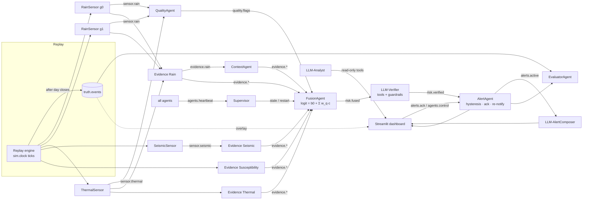

# Architecture

- **Bus**: append-only log with per-consumer offsets — SQLite WAL (demo, multi-process), in-memory (tests/batch). Envelope:
  `{msg_id, topic, agent_id, zone_id, sim_date, wall_ts, kind, payload, confidence, quality, evidence_ids}`.
- **Agents**: one OS process each (16 with the composer), heartbeat every 2 s, decision logic in pure step functions shared with batch evaluation (parity-tested).
- **Truth isolation**: only the evaluator and the dashboard overlay may read `truth.events` (bus access control + static test).
- **Quality**: modality weight 1.0 ok / 0.5 degraded / 0 missing; supervisor marks stale agents; deadlines close late days.
- **LLM**: verifier never raises a level; all rules enforced in code (`docs/llm_guardrails.md`).
